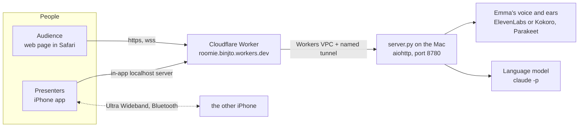

# Roomie

Roomie is a host for a crowded room. You tell Emma, by voice, what you are building and who you need. Your agent then asks every other attendee's agent whether the two of you should meet, and Emma introduces you to the one person who fits best. You get the things you have in common to start the conversation, and when you both say yes, your phones point you to each other.

Built for the Gen AI Summit Hackathon in Athens, 2026.

## How it works



1. **Talk to Emma.** Hold the mic button and answer a few questions. Emma speaks with a real voice and gestures with two 3D hands.
2. **Agents talk.** Your agent asks every other attendee's agent whether you should meet. You watch the conversations come in.
3. **The introduction.** Emma picks one person and says why.
4. **The room.** You see what you share (rare things first), open with one of Emma's suggested lines, and chat. Emma suggests follow-up questions.
5. **Find each other.** If you both say yes, an arrow and a distance lead you there: Ultra Wideband between two iPhones running the app, GPS and the compass on the web.

## Repository layout

| Path | What it is |
| --- | --- |
| [`server/`](server/) | The Python server: Emma's interview, matching, rooms, accounts. It also serves the web app. |
| [`server/web/`](server/web/) | The web app (a single page) and Emma's hands (three.js and Handkit). |
| [`app/`](app/) | The iPhone app: the web app full screen, with finding by Ultra Wideband and Bluetooth. |
| [`edge/`](edge/) | The Cloudflare Worker that gives Roomie its public https address. |
| [`docs/`](docs/) | Architecture, API, finding, and how to run everything. |
| [`prototypes/`](prototypes/) | An early standalone demo of the matching screen. |

## Quick start

You need a Mac with Emma's engine and Python environment in `~/Desktop/emma`, `cloudflared`, Xcode and XcodeGen.

```sh
make server      # Roomie on http://localhost:8780
make tunnel      # connect the Mac to Cloudflare
```

Then open **https://roomie.binjto.workers.dev** on any phone or computer. To build the iPhone app, run `make app` and open `app/Roomie.xcodeproj` in Xcode. `make help` lists every command.

The full setup, including the Worker and installing the app on phones, is in [docs/running.md](docs/running.md).

## Documentation

- [Architecture](docs/architecture.md): the parts, how a request travels, what is stored.
- [API](docs/api.md): every HTTP endpoint and WebSocket message.
- [Finding each other](docs/finding.md): Ultra Wideband, Bluetooth and GPS, and what was learned testing them.
- [Running Roomie](docs/running.md): server, tunnel, Worker, phones, and troubleshooting.

## Credits

Emma's hands are built on [Handkit](https://github.com/Ayushmaniar/3d-accurate-hands) (MIT, see `server/web/hands/HANDKIT_LICENSE`). 3D rendering by [three.js](https://threejs.org) (MIT).
