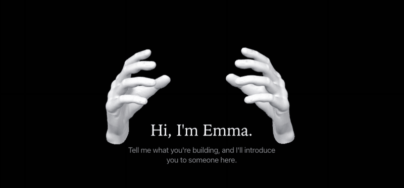
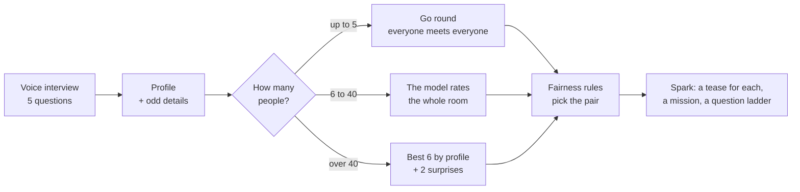

<div align="center">



# pairup

**Emma talks to everyone in the room, then sends two strangers to find each other with a reason to talk.**

Built at the Gen AI Summit Hackathon, Athens 2026.

</div>

---

## What it does

1. **Emma interviews you by voice** for about a minute: what you're building, what you need, what you could help with, where you're sitting, and one thing you could talk about for an hour that isn't work.
2. **She picks someone in the room for you.** The aim is not the most similar person. It's the one most likely to give you a conversation you enjoy.
3. **You both get half the story.** Each of you gets a line about the other ("ask Kai what's in the eleventh jar"), a two-minute mission to do together, and three questions that go from light to deep.

No scores and no percentages. Nobody sees the word "match".

## Why it's built this way

| What research found | What pairup does about it |
|---|---|
| Nobody can predict in advance which two strangers will click, not even machine learning ([Joel, Eastwick & Finkel 2017](https://www.psychologicalscience.org/news/releases/romantic-matches-are-hard-to-predict.html)) | It doesn't hunt for the perfect pair. It finds a good reason to start talking |
| Similarity you *feel* drives attraction more than similarity on paper ([Montoya et al. 2008](https://researchportal.murdoch.edu.au/esploro/outputs/journalArticle/Is-actual-similarity-necessary-for-attraction/991005635870107891)) | Emma frames the introduction and tells each person what to ask |
| A rare shared trait bonds people far more than a common one ([Alves 2018](https://scinapse.io/papers/2802513993)) | Rare words in two profiles weigh more than common ones, and Emma asks for one odd detail on purpose |
| At mixers people mostly talk to people they already know ([Ingram & Morris 2007](https://business.columbia.edu/insights/chazen-global-insights/what-really-happens-mixers)) | Emma does the walking-over part for you, with a mission so it isn't awkward |
| Talks with strangers, deep ones too, go better than people expect ([Epley & Schroeder 2014](https://pubmed.ncbi.nlm.nih.gov/25019381/), [Kardas et al. 2022](https://www.apa.org/news/press/releases/2021/09/deep-conversations-strangers)) | Every introduction ends with a question ladder that goes from light to real to deep |

## How a match happens



The code decides **who** meets whom. The model only rates a shortlist and writes the spark. If the model is down or makes up a name, the code still pairs people and writes a plain spark, so **there is always a match**.

### Five ways to pair two people

| Recipe | When |
|---|---|
| **useful** | One needs what the other can give |
| **twin** | They share something rare that few people in the room have |
| **pain** | They have the same frustration and can complain about it together |
| **clash** | They'd disagree, in a friendly way, about something low-stakes |
| **wildcard** | No obvious link: a small mission to find out what they share. In big rooms about 1 in 4 matches is a wildcard on purpose |

### Fairness

- Emma prefers people who hold fewer than 2 open introductions.
- People with no introduction yet come first.
- Nobody meets the same person twice, unless they have met everyone.
- In a round where everyone gets someone at once, an odd number makes one trio. Nobody is left out.

## What a match looks like

From a real run with Gemini, one attendee against a room of demo attendees:

> **Emma to Kai:** "Kai, I found your fellow finance defector. She designs interfaces for lost learners, and she needs someone who actually builds language agents."
>
> **To Kai:** Find Eleni and ask her how she escaped fintech. She might just skin your menu reader before morning.
>
> **To Eleni:** Go track down Kai and ask about his hot sauce stash; he used to wear a bank suit too.
>
> **Mission:** Translate a confusing foreign menu together and sketch a three-tap emergency interface on a napkin.
>
> **Ladder:** What's the weirdest thing you've ever tried to translate while travelling? → At what exact point did you realize banking was eating your soul? → Are we building language tools to connect with people, or to avoid asking for help?

## Run it

**Matching only** (no voice, Python 3.9+, standard library only):

```bash
cd server
echo "GEMINI_API_KEY=your-key" > .env      # without it, the model calls go through `claude -p`
python3 test_matching.py                 # the rules, no model
python3 test_matching.py --live          # a round for 29 people + one newcomer, sparks by the model
```

**The whole app** needs `aiohttp` and Emma's voice engine at `~/Desktop/emma`:

```bash
~/Desktop/emma/.venv/bin/python server/server.py     # http://<mac-ip>:8780
```

| Setting | Default |
|---|---|
| `GEMINI_API_KEY` | none: falls back to `claude -p` |
| `ROOMIE_GEMINI_MODEL` | `gemini-flash-latest` |
| `ROOMIE_MODEL` | `haiku` (for `claude -p`) |
| `PORT` | `8780` |

## Repo map

| Path | What |
|---|---|
| `server/matching.py` | Who meets whom, and the spark |
| `server/llm.py` | Gemini or `claude -p`: a prompt in, JSON out |
| `server/server.py` | Interview, match, chat, finding each other |
| `server/test_matching.py` | Rule checks and a live run |
| `server/web/index.html` | The web app, phone and desktop layouts |
| `server/web/hands/` | Emma's 3D hands (three.js + Handkit) |
| `server/sonar.py`, `server/web/sonar.html` | Finding each other in the hall by sound and GPS |

## Not done yet

- The "agents talking" screen still labels people "Strong fit / Maybe / Pass", and those labels don't affect who gets picked.
- Chains: after two people meet, Emma sends them together to a third.
- Learning: a one-tap "how did it go?" that makes the recipes that start good conversations come up more often.
- The app's own screens still say "Roomie".

## Credits

Emma's hands use [Handkit](server/web/hands/HANDKIT_LICENSE) by Ayush Maniar (MIT) and [three.js](https://threejs.org).
