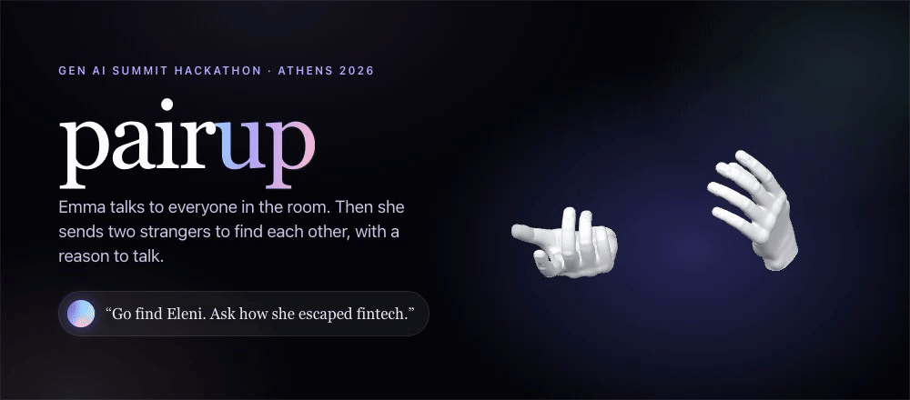
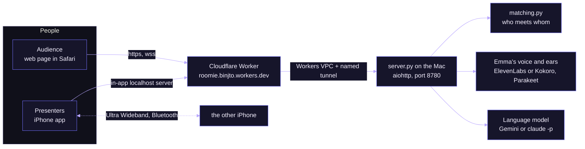

<div align="center">



<br>

**An AI host for a crowded room.**

<a href="https://roomie.binjto.workers.dev"></a>


[How it works](#how-a-match-happens) · [What you get](#what-you-get) · [Why](#why-its-built-this-way) · [Under the hood](#under-the-hood) · [Run it](#run-it)

</div>

<br>

At a hackathon of a hundred builders, most people end up talking to the people they came with. pairup gives the room a host.

You talk to **Emma** for about a minute. Your agent asks the other attendees' agents whether you should meet. Then Emma sends you to one person, with half the story, a two-minute mission and three questions to ask.

No scores. No percentages. Nobody sees the word "match".

## How a match happens



**The code decides who meets whom. The model writes the words.** The agents' verdicts weigh 80%, the two profiles 20%, and fairness rules keep anyone from being left out. If the model is down or invents a name, the code still pairs people and writes a plain introduction. **There is always a match.**

## What you get



Each of you gets half the story: a name and one thing to ask. The reason you'll find out by talking. When you both say yes, an arrow and a distance lead you to each other.

## Five ways to pair two people



The best pair isn't always the most similar one. Sometimes it's two people who need each other, sometimes two who'd argue about something small. In a big room, a few pairs are wildcards on purpose.

## Why it's built this way

| What research found | What pairup does about it |
|---|---|
| Nobody can predict which two strangers will click, not even machine learning ([Joel, Eastwick & Finkel 2017](https://www.psychologicalscience.org/news/releases/romantic-matches-are-hard-to-predict.html)) | It doesn't hunt for the perfect pair. It finds a good reason to start talking |
| Similarity you *feel* drives attraction more than similarity on paper ([Montoya et al. 2008](https://researchportal.murdoch.edu.au/esploro/outputs/journalArticle/Is-actual-similarity-necessary-for-attraction/991005635870107891)) | Emma frames each introduction and tells each person what to ask |
| A rare shared trait bonds people far more than a common one ([Alves 2018](https://scinapse.io/papers/2802513993)) | Rare words in two profiles weigh more than common ones, and Emma keeps the odd human details |
| At mixers people mostly talk to people they already know ([Ingram & Morris 2007](https://business.columbia.edu/insights/chazen-global-insights/what-really-happens-mixers)) | Emma does the walking-over part, and the mission makes it easy |
| Talks with strangers, deep ones too, go better than people expect ([Epley & Schroeder 2014](https://pubmed.ncbi.nlm.nih.gov/25019381/), [Kardas et al. 2022](https://www.apa.org/news/press/releases/2021/09/deep-conversations-strangers)) | Every introduction ends with three questions, from light to real to deep |

### Fair to the whole room

- People with no introduction yet come first.
- Someone with two unanswered introductions counts as busy, for 20 minutes or until they answer.
- Nobody meets the same person twice, unless they've met everyone.
- If you said whom you'd rather not meet, they drop down your list.
- A strong verdict from the agents is never swapped for a wildcard.
- When everyone is paired at once and the count is odd, one pair becomes a trio. Nobody is left out.

## Under the hood



- **Emma** speaks with a real voice and signs with two 3D hands (three.js and Handkit) while she talks.
- **Matching** is plain Python with no dependencies: [`server/matching.py`](server/matching.py).
- **The model** is Gemini when `GEMINI_API_KEY` is set, otherwise one-shot `claude -p` calls. A prompt goes in, JSON comes out: [`server/llm.py`](server/llm.py).
- **Finding each other** uses Ultra Wideband between two iPhones running the app, and GPS with the compass on the web.

## Run it

You need a Mac with Emma's engine and Python environment in `~/Desktop/emma`, `cloudflared`, Xcode and XcodeGen.

```sh
make server      # http://localhost:8780
make tunnel      # connect the Mac to Cloudflare
```

Then open **https://roomie.binjto.workers.dev** on any phone or computer. To build the iPhone app, run `make app` and open `app/Roomie.xcodeproj` in Xcode. `make help` lists every command. The full setup is in [docs/running.md](docs/running.md).

**Just the matching**, with no voice and nothing to install:

```sh
cd server
echo "GEMINI_API_KEY=your-key" > .env   # optional, else claude -p
python3 test_matching.py                # the rules, no model
python3 test_matching.py --live         # a whole room, with the model
```

## Repository

| Path | What it is |
| --- | --- |
| [`server/`](server/) | The Python server: Emma's interview, matching, rooms, accounts. It also serves the web app. |
| [`server/matching.py`](server/matching.py) | Who meets whom, and the words that get them talking. |
| [`server/web/`](server/web/) | The web app (a single page) and Emma's hands. |
| [`app/`](app/) | The iPhone app: the web app full screen, with finding by Ultra Wideband and Bluetooth. |
| [`edge/`](edge/) | The Cloudflare Worker that gives the app its public https address. |
| [`docs/`](docs/) | [Architecture](docs/architecture.md), [API](docs/api.md), [finding each other](docs/finding.md), [running everything](docs/running.md). |
| [`prototypes/`](prototypes/) | An early standalone demo of the matching screen. |

The app, the Xcode project and the public address still use the working name Roomie.

## Next

- **Chains.** After two people meet, Emma sends them together to a third. Teams form that way.
- **Learning.** A one-tap "how did it go?" so the kinds of pairs that start good conversations come up more often.

## Credits

Emma's hands are built on [Handkit](https://github.com/Ayushmaniar/3d-accurate-hands) (MIT, see `server/web/hands/HANDKIT_LICENSE`). 3D rendering by [three.js](https://threejs.org) (MIT).

<div align="center">
<br>
<sub>Built in 36 hours at the Gen AI Summit Hackathon, Athens 2026.</sub>
</div>
