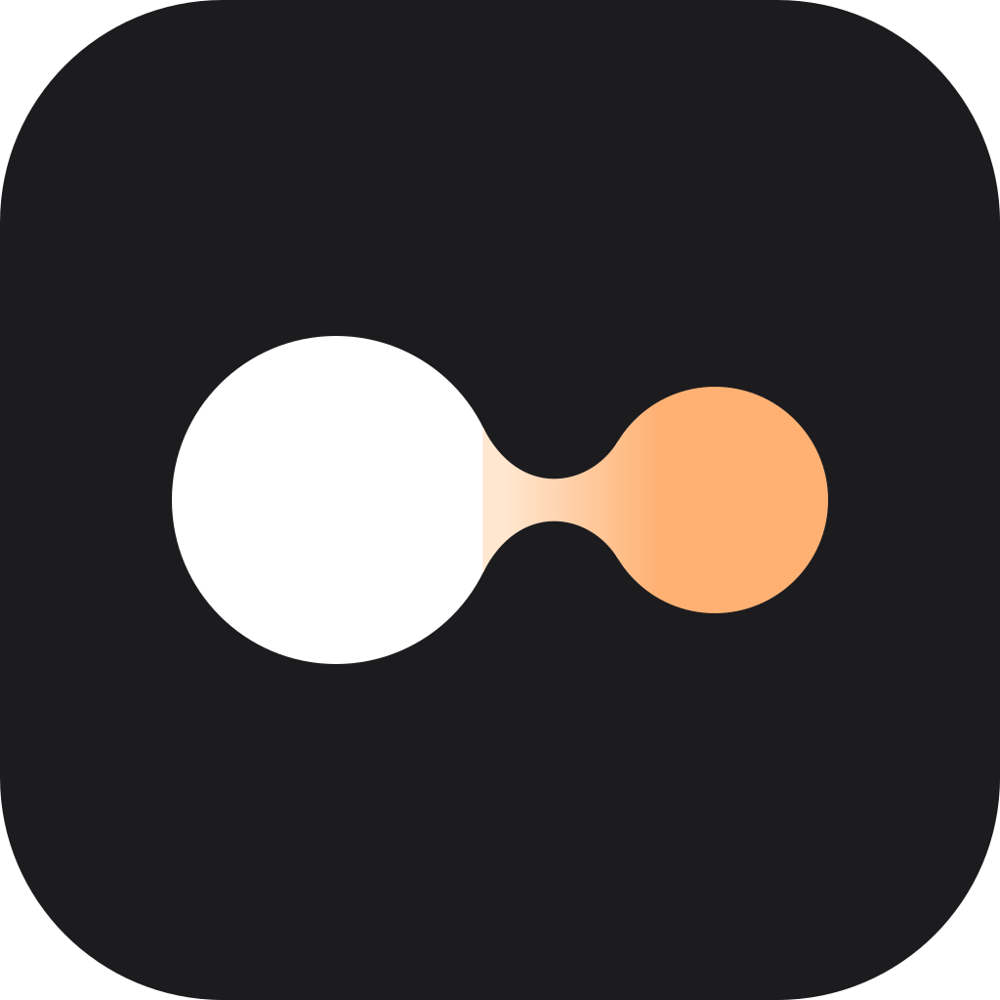
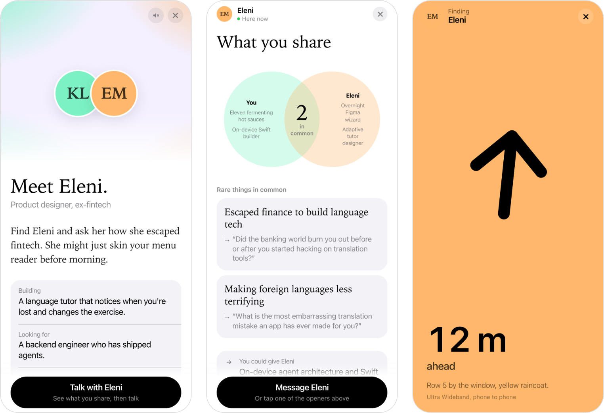
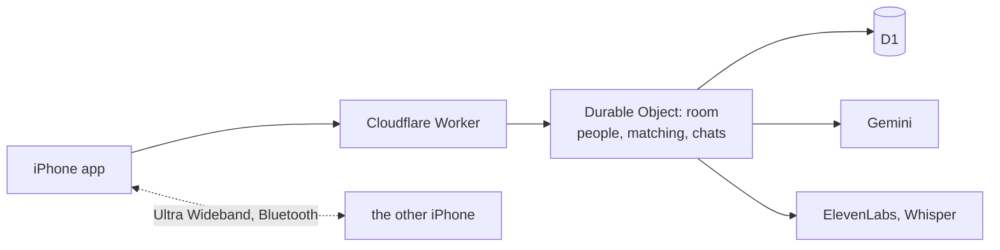

<p align="center">
  
</p>

<h1 align="center">PairShake</h1>

<p align="center">
  A host for a crowded room.<br>
  Built at the Gen AI Summit Hackathon, Athens 2026.
</p>

<br>

You tell Emma, by voice, what you're building and who you need. Your agent asks the other attendees' agents whether the two of you should meet. Emma introduces you to one person, with something to ask them and a short mission to do together. When you both say yes, your phones point you to each other.

<p align="center">
  
</p>

## How it works

1. **Talk to Emma.** Hold the mic and answer a few questions.
2. **Agents talk.** Your agent asks up to eight other attendees' agents whether you should meet. You watch the answers come in.
3. **The introduction.** Emma tells each of you who the other is and one thing to ask them, gives you a two-minute mission, and three questions that go from light to deep.
4. **The room.** You see what you share, rare things first, and chat. Emma suggests openers and follow-up questions.
5. **Find each other.** If you both say yes, an arrow and a distance lead you there: Ultra Wideband between the two iPhones, Bluetooth and GPS when it can't reach.

## Matching

Nobody can predict which two strangers will click ([Joel, Eastwick & Finkel 2017](https://www.psychologicalscience.org/news/releases/romantic-matches-are-hard-to-predict.html)), and a rare thing in common bonds people more than a common one ([Alves 2018](https://scinapse.io/papers/2802513993)). So PairShake doesn't look for a perfect match. It looks for a good reason to start talking.

- **Code picks the pair, the model writes the words.** The agents' verdicts count for 80%, the two profiles for 20%.
- **Five kinds of pair:** one needs what the other offers (useful), something rare in common (twin), the same frustration (pain), a friendly disagreement (clash), or no link at all (wildcard).
- **Fair to the room.** People with no introduction yet go first. Two unanswered introductions make someone busy for 20 minutes. Nobody meets the same person twice.
- **Always a match.** If the model fails, the code still pairs people and writes a plain introduction.

The code is in [`edge/src/matching.js`](edge/src/matching.js).

## Architecture



| Path | What it is |
| --- | --- |
| [`edge/`](edge/) | The backend, all on Cloudflare: Emma's interview, matching, rooms, accounts, voice. It also serves the app's page. |
| [`app/`](app/) | The iPhone app: its page (`app/web/`) full screen, with finding by Ultra Wideband and Bluetooth. |
| [`docs/`](docs/) | Architecture, API, finding, and how to run everything. |
| [`prototypes/`](prototypes/) | An early standalone demo of the matching screen. |

## Run it

PairShake runs entirely on Cloudflare. With `wrangler` signed in:

```sh
make edge        # deploy to pairshake.binjto.workers.dev
make backup      # save a copy of the room
```

To build the iPhone app, run `make app` and open `app/Roomie.xcodeproj` in Xcode. `make help` lists every command. The full setup, including secrets, logs and installing the app on phones, is in [docs/running.md](docs/running.md).

## Documentation

- [Architecture](docs/architecture.md): the parts, how a request travels, what is stored.
- [API](docs/api.md): every HTTP endpoint and WebSocket message.
- [Finding each other](docs/finding.md): Ultra Wideband, Bluetooth and GPS, and what was learned testing them.
- [Running PairShake](docs/running.md): deploying, logs, backups, phones, and troubleshooting.
