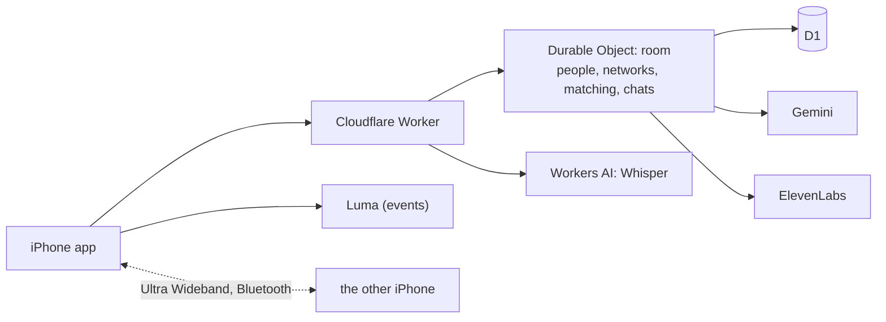

<p align="center">
  
</p>

<h1 align="center">PairShake</h1>

<p align="center">
  A host for a crowded room.<br>
  Built at the Gen AI Summit Hackathon, Athens, 14–15 November 2026.
</p>

<br>

**Who it's for:** anyone at an event, a conference or a co-working space who came to meet people.

**The problem:** a room full of strangers. You don't know who is worth talking to, it's awkward to walk up to someone, and the person you needed was there all along and you never met.

**What PairShake does:** your AI agent talks to everyone else's agents in the room and finds the one person you should meet right now. You both get a card, you both say yes, and your phones point you to each other across the room.

<p align="center">
  
</p>

## How it works

1. **Introduce yourself with the AI you already use.** One tap copies a question and opens ChatGPT, Claude or Gemini, which already know you. Paste its answer back, and PairShake has your profile: what you're building, what you need, what you can offer. No AI of your own? Answer a few questions instead.
2. **Join a room.** Create a network and share its QR code or link, scan someone else's, or pick the Luma event you're at. Events that haven't started yet show in the search but can't be joined until they start.
3. **Agents talk.** Inside a network your agent starts by itself. It asks the other attendees' agents whether the two of you should meet, while a ring of hands on screen shakes each agent's hand in turn (a thumbs-up for a yes).
4. **Someone for you.** When it finds someone, you get a card with no name and no face: someone here right now you should meet. You have ten seconds to tap Let's go. If they tap it too, you go straight to finding each other.
5. **Find each other.** An arrow and a distance lead you to them: Ultra Wideband between the two iPhones, Bluetooth and GPS when it can't reach. Within 2 m (or when one of you taps I found them), both phones know at once, and only then do you see who it is.

Someone you have already met is never introduced to you again.

## Matching

Nobody can predict which two strangers will click ([Joel, Eastwick & Finkel 2017](https://www.psychologicalscience.org/news/releases/romantic-matches-are-hard-to-predict.html)), and a rare thing in common bonds people more than a common one ([Alves 2018](https://scinapse.io/papers/2802513993)). So PairShake doesn't look for a perfect match. It looks for a good reason to start talking.

- **A judge reads the room.** Gemini Decision 1 answers three closed questions about you and each other person: would a five-minute talk be worth your time, would it be worth theirs, and what is the best reason to talk (one needs what the other offers, something rare in common, the same frustration, a friendly disagreement, or none). The answers are kept per pair and asked again only when a profile changes.
- **Code picks the pair, the model writes the words.** A pair scores high only when there is a reason to talk and both sides find it worth their time. The judge's answers (or, without them, the agents' verdicts) count for 80%, the two profiles for 20%.
- **Two agents per talk.** Your agent knows you and only the other person's public card, and asks. Their agent knows them and only your public card, and answers for them, yes or no. If the best person's agent says no, the next best is asked.
- **You decide what others see.** Any part of your card can be hidden. Hidden parts still help pick who you meet, but nothing written for anyone else is made from them. At least one part has to stay visible.
- **Fair to the room.** People with no introduction yet go first, and nobody is introduced to the same person twice.
- **Always an answer.** If the judge doesn't answer, up to eight agents' verdicts decide. If the model fails, the code still pairs people and writes a plain introduction.

The code is in [`edge/src/matching.js`](edge/src/matching.js).

## Built with

- **Gemini** (Flash and Flash-Lite, and Decision 1 for the judge): profiles, the agents' talks, matching, the introduction.
- **ElevenLabs**: Emma's voice. **Workers AI (Whisper)**: her ears.
- **Cloudflare**: a Worker, a Durable Object for the room, D1 for the data, R2 for every line Emma has said.
- **iPhone app** (Swift): the page full screen, plus Ultra Wideband (Nearby Interaction), Bluetooth and GPS for finding each other.
- **three.js**: Emma's 3D hands and the handshake ring.

## Architecture



| Path | What it is |
| --- | --- |
| [`edge/`](edge/) | The backend, all on Cloudflare: profiles, networks and events, matching, accounts, voice. It also serves the app's page. |
| [`app/`](app/) | The iPhone app: its page (`app/web/`) full screen, with finding by Ultra Wideband and Bluetooth. |
| [`docs/`](docs/) | Architecture, API, finding, and how to run everything. |
| [`prototypes/`](prototypes/) | An early standalone demo of the matching screen. |

## Run it yourself

PairShake is an iPhone app with its backend on Cloudflare. To run your own copy you need a Cloudflare account, Node.js, a Mac with Xcode 16+ and [XcodeGen](https://github.com/yonaskolb/XcodeGen) (`brew install xcodegen`), and an iPhone with iOS 18 or later (finding by Ultra Wideband needs an iPhone 11 or newer; older ones use Bluetooth and GPS).

**1. The backend**

```sh
npx wrangler login
cd edge
npx wrangler d1 create pairshake              # copy the database_id it prints
npx wrangler r2 bucket create pairshake-voice
```

In `edge/wrangler.jsonc`, put your own `account_id` and the new `database_id`. Then create the tables and add the keys:

```sh
npx wrangler d1 migrations apply pairshake --remote
npx wrangler secret put GEMINI_API_KEY         # Google AI Studio
npx wrangler secret put ELEVENLABS_API_KEY     # Emma's voice
npx wrangler secret put ADMIN_TOKEN            # any long random string (for backups)
npx wrangler secret put LINKEDIN_CLIENT_ID     # sign-in: a LinkedIn app and a Google OAuth client,
npx wrangler secret put LINKEDIN_CLIENT_SECRET #   each with the redirect URL
npx wrangler secret put GOOGLE_CLIENT_ID       #   https://<your worker>/auth/linkedin/callback
npx wrangler secret put GOOGLE_CLIENT_SECRET   #   and .../auth/google/callback
cd .. && make edge                             # copies app/web into the Worker and deploys
```

**2. The iPhone app**

In `app/PairShake/Server.swift`, set `fallback` to your Worker's address. Then:

```sh
make app                       # generates app/PairShake.xcodeproj
open app/PairShake.xcodeproj
```

Pick your team in Signing & Capabilities, choose your iPhone and run. The first time, trust the developer certificate in Settings → General → VPN & Device Management, and allow the microphone, Bluetooth, Nearby Interaction, camera and location.

To try matching you need at least two people in the same network, so two iPhones. The test tools (the hammer on the first page) can pair two test phones directly.

`make help` lists every command. Logs, backups, installing on several phones and troubleshooting are in [docs/running.md](docs/running.md).

## Documentation

- [Architecture](docs/architecture.md): the parts, how a request travels, what is stored.
- [API](docs/api.md): every HTTP endpoint and WebSocket message.
- [Finding each other](docs/finding.md): Ultra Wideband, Bluetooth and GPS, and what was learned testing them.
- [Running PairShake](docs/running.md): deploying, logs, backups, phones, and troubleshooting.
