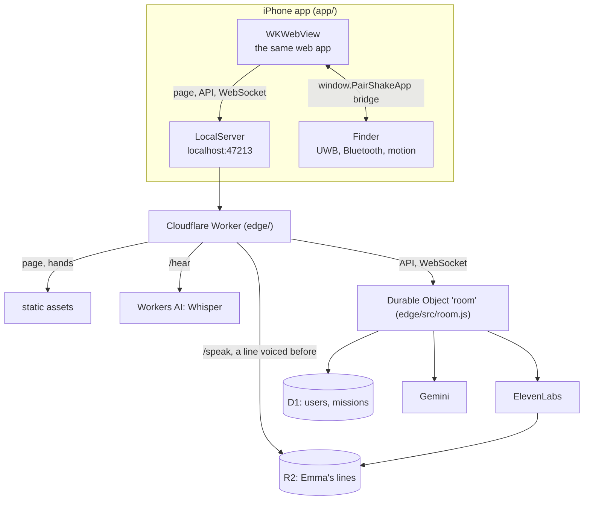

# Architecture

PairShake is an iPhone app with its backend on Cloudflare; nothing runs on a Mac. Two parts: the backend (a Worker and one Durable Object, `edge/`) and the app (`app/`), whose screens are one web page (`app/web/`) shown full screen.

## Backend (`edge/`)

A Cloudflare Worker (`edge/src/index.js`) in front of one Durable Object, the room (`edge/src/room.js`), with a D1 database behind it. All JavaScript. The room is the only place that changes state; every request that needs it goes to the same object, so everyone sees the same people and matches.

**What it stores.** The D1 database `pairshake` (`edge/migrations/`) has a `users` table (one row per person: id, email, name, app, test, has_profile, created and updated times, and the whole record as JSON in `data`), a `missions` table (one row per introduction: the two people, the outcome, times, and the record with its chat in `data`) and `meta` (the room's counts). The room loads it all when it starts, works in memory, and writes each change through right after, so restarts and deploys lose nothing. `make backup` saves a copy:

- `users`: one record per attendee. A random 10-character id, Emma's transcript, the profile she wrote (name, role, what they are building, what they need, what they offer, where they are standing), social handles, a colour, introductions waiting for them (`inbox`), and flags: `app` (joined from the iPhone app), `test` (a made-up attendee from the test button). With an account, also an email and a salted PBKDF2-SHA256 hash of the password.
- `missions`: one per introduction. Who the two people are, Emma's note to each, what they share (`overlap`), the chat, each person's yes or no, and the outcome.
- `stats`: the room's counts (`/room`).

Rooms (who is connected to which introduction right now) are the Durable Object's WebSockets, with hibernation: an open chat costs nothing while nobody types. A match being worked out and the agents' talks are kept only in memory.

**Seed attendees.** Ten fictional people are kept in the code, but only real people are introduced: with nobody else in the room, the answer is "Nobody new to meet here yet".

**Language model.** Every step is a Gemini call (`edge/src/llm.js`). The writing comes back as JSON: flash-lite (about 1 s) for the chat and the quick jobs, flash (about 3 s) for the spark and the agents' talk. A failed call is tried once more. The judge is Gemini Decision 1, through Google's Decisions API: closed questions about one text, answered as probabilities in one pass, with no text written; a call that fails because the API is busy or slow is tried once more. At most 16 calls are in flight at once.

| Step | When | What it asks for |
| --- | --- | --- |
| Interview | each answer | Emma's next line, and whether she has heard enough |
| Profile | after the interview | the attendee's card, with the odd details worth asking about |
| Judge | once the profile is written, one call for everyone the attendee hasn't been judged with yet (up to 333 people a call) | for each other person: is a talk worth the attendee's time, is it worth theirs, and which kind of reason fits |
| Scan | after the judge, two calls per talk: 3 talks when the judge answered, up to 8 when it didn't | your agent's question; their agent's reply, yes or no, and a fit score |
| Spark | once the pair is chosen, two calls in parallel | Emma's line to each of them, a small mission, three questions, what the two share |
| Agent talk, suggestions, welcome back | later | the opening exchange, follow-up questions, Emma's greeting next time |

**Choosing the pair** (`edge/src/matching.js`). The pair is chosen in code; the model only judges and writes.

1. The attendee's profile is written first (in English whatever they spoke; what they can offer is read from their work if they didn't say). Looking again without a new chat reuses their card as it is now, with whatever they changed on the You page.
2. The judge, Gemini Decision 1, reads the attendee's card and everyone else's (with their persona when there is one). For each other person it answers three closed questions: would a five-minute talk be worth the attendee's time, would it be worth the other person's (no if either said they'd rather not meet people like that), and which kind of reason fits best: useful, twin, pain, clash, or none. The answers are kept in the room's memory per pair and read from both sides; a pair is judged again only when one of the two profiles changes. The match waits at most 5 seconds for the judge; answers that come later are kept for the next match.
3. The pair is chosen in code from those answers. A pair scores high only when there is a reason to talk and both sides find it worth their time, so a talk only one side wants scores low. The judge's score counts for 80%, the cards for 20% (rare words count more), and then comes the fairness adjustment: people nobody has introduced yet first, people already holding two unanswered introductions and the seed attendees last. The judge's kind of reason sets the kind of introduction.
4. Then the attendee's agent talks to the chosen person and the next two. Each talk is two agents, one model call each. The attendee's agent knows its own person and only the other's public card, and asks. The other person's agent knows its own person (whom they'd rather not meet, how many introductions they haven't answered) and only the attendee's public card, and answers yes or no for them. If the chosen person's agent says no, that person is set aside and the next best is chosen. Emma waits 9 seconds for these talks (13 if fewer than two are back).
5. If the judge answered for fewer than half the room (it is down or too slow), the agents decide. The attendee's agent is sent to the people most worth a talk: 8 when the room is quiet, 4 or 3 when others are matching too, in order of their cards and the same fairness. Each talk ends in a fit score, and anyone whose agent said no is set aside. The best one wins, steadied by the cards (80% the agents, 20% the cards) and after the same fairness adjustment, so the match agrees with what the matching screen showed. Emma waits 9 seconds after the profile for the agents (13 if fewer than two are back); after that the cards decide.
6. Talks take turns by rank, so everyone's first choices are heard before anyone's fifth, and a talk still waiting after 7 seconds is dropped.
7. Someone who said whom they'd rather not meet is rarely sent that kind of person, or sent to them: it counts heavily against the pair in the cards, and the judge and their agent are asked to say no.
8. An introduction to a seed attendee doesn't count: whoever only got one of those is first in line when a real person arrives. An introduction nobody answered for 20 minutes no longer counts against that person either.
9. People matching at the same moment see each other's choices, so they don't all pick the same person.
10. In a room of five or fewer, people simply go round. In a room of more than 40, one match in four goes to someone unexpected, unless the judge or the agents found a strong fit.
11. Traits only shape the tone of the introduction, never who meets whom. Three are used, how playful, how direct and how open to strangers each one is, and only when they were read with a confidence of at least 0.4 ([traits.md](traits.md)). Both playful: a more playful mission. Both hesitant with strangers: an easier first question and a low-pressure mission. Either one direct: direct questions. This adds one line to the spark's prompt, which says how to write and nothing about the people; with no usable trait there is no line.
12. If the model fails at any step, the code still pairs people and writes a plain introduction.
13. One match at a time per person. Stop, or a second tap on Find, drops the match being worked out: it introduces nobody. Two people who find each other at the same moment share one introduction. If the person chosen left the room, paused or deleted their account before the introduction is made, Emma looks again.

At most 16 model calls run at once, at most 12 of them agents' talks, however many people are matching.

**Who can meet whom.** People on the iPhone app only meet other app users (so their phones can find each other by Ultra Wideband). Test attendees never start or appear in real matches.

**Voice.** `/speak` turns Emma's line into a WAV with ElevenLabs, once: every line is kept in the R2 bucket `pairshake-voice` and served from there ever after. It only voices lines Emma really says (her script, what she said lately, the page's own lines about someone in the room). If ElevenLabs is down, Workers AI's voice stands in and that line isn't kept. `/hear` takes 16 kHz mono PCM and returns Whisper's transcript (Workers AI). The script's lines are checked at start-up, so the first seconds are instant.

## The app's page (`app/web/index.html`)

One page, no build step, served by Cloudflare only to the app (a browser gets a short note that PairShake is an iPhone app). The main pieces, in the order an attendee meets them:

- **Voice and Ears.** Emma's audio plays through Web Audio. Your answer is recorded only while you hold the mic button, sent to `/hear`, and the turn ends when you let go. The browser's own speech recogniser is only a fallback.
- **Hands.** `hands/hands.js` draws Emma's two hands with three.js and plans gestures from what she says; `hands/worker.js` runs the Handkit solver off the main thread. `hands/ring.js` is the matching screen: your hand shakes each agent's hand in turn, from a pre-baked animation (`ring.bin`).
- **Matching.** Polls `/scan` and acts out each agent conversation as it arrives, then settles on the person `/match` picked. It can be stopped, which also drops the match on the server.
- **Room.** A WebSocket per introduction carries the chat, typing, presence, each person's decision, and the data the phones use to find each other.
- **Finding.** GPS through a small Kalman filter and the compass fused with the gyroscope, until the radios take over (see [finding.md](finding.md)).
- **Home, settings, account.** Returning people see what Emma remembers and the people they have met. Settings hold the account, name and handles, Emma's voice (off until turned on; a speaker button on the screens where she talks does the same), vibration, and in the app the server and version.

## iPhone app (`app/`)

The app shows its page (`app/web/`) full screen; the Swift side adds what a page cannot do.

- **`WebShell.swift`** hosts the WKWebView. It injects `window.PairShakeApp` (the bridge), replaces the page's GPS with Core Location, grants microphone and motion without web prompts, plays haptics, keeps the screen awake, and shrinks the page above the keyboard (see the iOS 26 note in [running.md](running.md)). If the server can't be reached it shows "Connecting…" and retries every 2 seconds. Shaking the phone opens the server address.
- **`LocalServer.swift`** serves the page from `http://localhost:47213`. Localhost counts as a secure page, so the microphone works. The hands' models and three.js ship inside the app; each model is still checked against Cloudflare's copy with one small `If-None-Match` request (both sides use the file's mtime-size as the ETag), so a re-baked model wins at once. Everything else, including the room's WebSocket, is passed through to the server.
- **`Server.swift`** chooses the server: an address typed in by hand if it answers, otherwise the Cloudflare address.
- **`Finder.swift`** finds the other phone with Nearby Interaction (Ultra Wideband), a Bluetooth link between the two phones, and the gyroscope. Its readings reach the page about 15 times a second.
- **`Legacy/`** is the first, fully native SwiftUI version, kept for reference and not compiled.

## Security and privacy

- A user id is a random secret; whoever has it is that user. It lives in the device's local storage.
- Accounts are an email and a password. Passwords are stored only as salted PBKDF2-SHA256 hashes, and sign-in attempts are throttled after five failures.
- The API keys (Gemini, ElevenLabs) and the admin token are Worker secrets, never in the repository. Local copies of the Gemini key and the admin token live in `edge/.dev.vars`, which git ignores, as do backups.
- Calls that cost money are rate limited per address, and `/speak` won't voice text Emma doesn't say.
- Deleting an account removes the user record; introductions that pointed to it stop showing that person.
