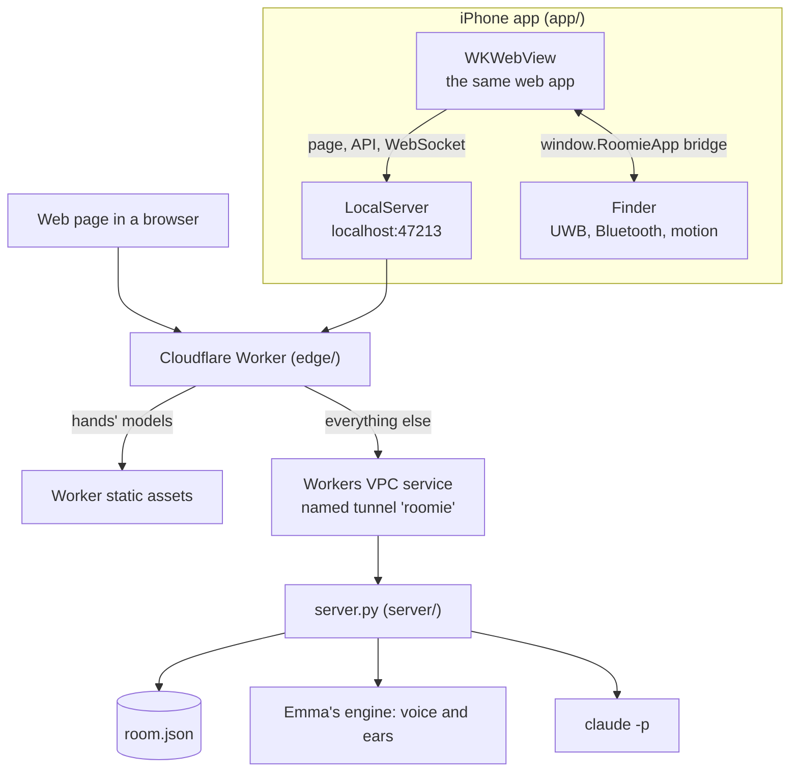

# Architecture

Roomie has four parts: a Python server on a Mac, a single-page web app, an iPhone app, and a Cloudflare Worker in front of all of it.

## Server (`server/server.py`)

An aiohttp app on port 8780. It is the only place with state.

**What it stores.** Everything lives in memory and is written to `server/room.json` after each change, so a restart loses nothing:

- `users`: one record per attendee. A random 10-character id, Emma's transcript, the profile she wrote (name, role, what they are building, what they need, what they offer, where they are standing), social handles, a colour, introductions waiting for them (`inbox`), and flags: `app` (joined from the iPhone app), `test` (a made-up attendee from the test button). With an account, also an email and a salted scrypt hash of the password.
- `missions`: one per introduction. Who the two people are, Emma's note to each, what they share (`overlap`), the chat, each person's yes or no, and the outcome.
- `stats`: counts for the room screen.

Rooms (who is connected to which introduction right now) are kept only in memory.

**Seed attendees.** Ten fictional people are always in the room, so the first real attendee still has someone to meet. When someone is introduced to one of them, Emma plays that person in the chat.

**Language model.** Every decision is a one-shot `claude -p` call (model set by `ROOMIE_MODEL`, Haiku by default) that returns JSON. With `GEMINI_API_KEY` set (in the environment or in `server/.env`), Gemini answers instead (`server/llm.py`).

| Step | When | What it asks for |
| --- | --- | --- |
| Interview | each answer | Emma's next line, and whether she has heard enough |
| Scan | once the profile is written, one call per candidate (up to 8) | your agent's question, their agent's reply, a fit score |
| Profile | after the interview | the attendee's card, with the odd details worth asking about |
| Spark | once the pair is chosen, two calls in parallel | Emma's line to each of them, a small mission, three questions, what the two share |
| Agent talk, suggestions, welcome back | later | the opening exchange, follow-up questions, Emma's greeting next time |

**Choosing the pair** (`server/matching.py`). The pair is chosen in code; the model only judges and writes.

1. The attendee's profile is written first (in English whatever they spoke; what they can offer is read from their work if they didn't say).
2. Their agent is sent to the people most worth a talk: 8 when the room is quiet, 4 or 3 when others are matching too. The order comes from the cards (rare words count more), with people nobody has introduced yet first, and people already holding two unanswered introductions and the seed attendees last. Talks take turns by rank, so everyone's first choices are heard before anyone's fifth, and a talk still waiting after 7 seconds is dropped.
3. Each talk ends in a fit score. The best one wins, steadied by the cards and after the same fairness adjustment, so the match agrees with what the matching screen showed. Emma waits 9 seconds for the agents (13 if fewer than two are back); after that the cards decide.
4. Someone who said whom they'd rather not meet isn't sent that kind of person, and isn't sent to them.
5. An introduction to a seed attendee doesn't count: whoever only got one of those is first in line when a real person arrives. An introduction nobody answered for 20 minutes no longer counts against that person either.
6. People matching at the same moment see each other's choices, so they don't all pick the same person.
7. In a room of five or fewer, people simply go round. In a room of more than 40, one match in four goes to someone unexpected, unless the agents found a strong fit.
8. If the model fails at any step, the code still pairs people and writes a plain introduction.

At most 12 agent talks and 8 other model calls run at once, however many people are matching.

`matching.py` also has rounds (everyone paired at once, a trio for an odd count), not yet used by the server. Its rules are checked by `server/test_matching.py`.

**Who can meet whom.** People on the iPhone app only meet other app users (so their phones can find each other by Ultra Wideband); people on the web only meet web users. The seed attendees are in both. Test attendees never appear in real matches. The first app user, with nobody else on the app yet, gets a seed person, and is introduced to the next app user through their inbox.

**Voice.** `/speak` turns Emma's line into a WAV with her own engine (ElevenLabs, with the local Kokoro voice as fallback). `/hear` takes 16 kHz mono PCM and returns Parakeet's transcript. The common lines are rendered at start-up so the first seconds are instant.

## Web app (`server/web/index.html`)

One page, no build step. It works in a phone browser and on a computer (a two-column layout from 900 px). The main pieces, in the order an attendee meets them:

- **Voice and Ears.** Emma's audio plays through Web Audio. Your answer is recorded only while you hold the mic button, sent to `/hear`, and the turn ends when you let go. The browser's own speech recogniser is only a fallback.
- **Hands.** `hands/hands.js` draws Emma's two hands with three.js and plans gestures from what she says; `hands/worker.js` runs the Handkit solver off the main thread. `hands/ring.js` is the matching screen: your hand shakes each agent's hand in turn, from a pre-baked animation (`ring.bin`).
- **Matching.** Polls `/scan` and acts out each agent conversation as it arrives, then settles on the person `/match` picked. It can be stopped, which also drops the match on the server.
- **Room.** A WebSocket per introduction carries the chat, typing, presence, each person's decision, and the data the phones use to find each other.
- **Finding.** On the web: GPS through a small Kalman filter and the compass fused with the gyroscope. In the app the radios take over (see [finding.md](finding.md)).
- **Home, settings, account.** Returning people see what Emma remembers and the people they have met. Settings hold the account, name and handles, Emma's loudness, vibration, and in the app the server and version.

## iPhone app (`app/`)

The app shows the web app full screen, so the two never drift apart; what the app adds is what a browser cannot do.

- **`WebShell.swift`** hosts the WKWebView. It injects `window.RoomieApp` (the bridge), replaces the page's GPS with Core Location, grants microphone and motion without web prompts, plays haptics, keeps the screen awake, and shrinks the page above the keyboard (see the iOS 26 note in [running.md](running.md)). If the server can't be reached it shows "Connecting…" and retries every 2 seconds. Shaking the phone opens the server address.
- **`LocalServer.swift`** serves the page from `http://localhost:47213`. Localhost counts as a secure page, so the microphone works. The hands' models and three.js ship inside the app; each model is still checked against the server's copy with one small `If-None-Match` request, so a re-baked model wins at once. Everything else, including the room's WebSocket, is passed through to the server.
- **`Server.swift`** chooses the server: an address typed in by hand if it answers, otherwise the Cloudflare address.
- **`Finder.swift`** finds the other phone with Nearby Interaction (Ultra Wideband), a Bluetooth link between the two phones, and the gyroscope. Its readings reach the page about 15 times a second.
- **`Legacy/`** is the first, fully native SwiftUI version, kept for reference and not compiled.

## Edge (`edge/`)

A Cloudflare Worker at `roomie.binjto.workers.dev` is the public address for both the audience and the app.

- The hands' heavy files (about 7 MB) are deployed with the Worker as static assets, so phones get them from the nearest Cloudflare data centre. Each request still asks the Mac whether its copy changed (a 304 when it hasn't). If the Mac is away, the edge copy is used.
- Everything else goes to `server.py` through a Workers VPC service bound to the named tunnel `roomie`, which `cloudflared` keeps open from the Mac over HTTP/2. No public hostname or open port is needed.

## Security and privacy

- A user id is a random secret; whoever has it is that user. It lives in the device's local storage.
- Accounts are an email and a password. Passwords are stored only as salted scrypt hashes, and sign-in attempts are throttled after five failures.
- The tunnel token is kept in `~/.cloudflared/roomie.token`, outside the repository. `room.json`, logs and the local TLS key are ignored by git.
- Deleting an account removes the user record; introductions that pointed to it stop showing that person.
